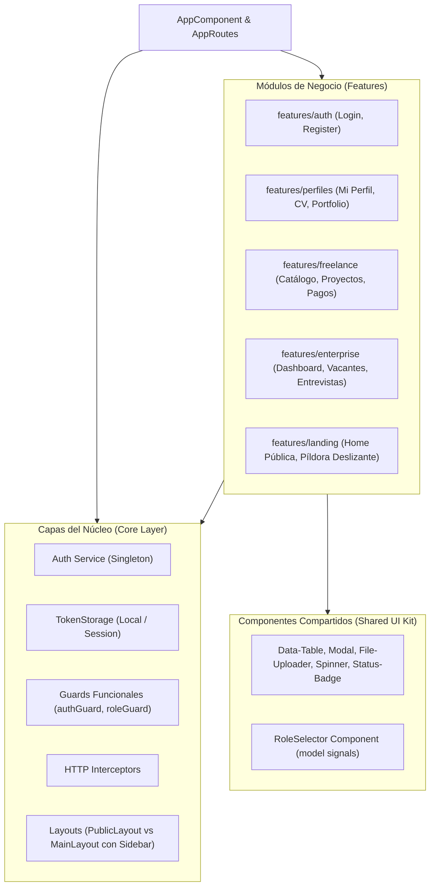

# 💼 WorkLink — Plataforma de Conexión Laboral y Servicios Freelance

<p align="center">
  
</p>

<p align="center">
  <strong>El punto de encuentro definitivo entre talento especializado, clientes y empresas.</strong>
</p>

<p align="center">
  
  
  
  
  
</p>

---

## 📖 Tabla de Contenidos
- [Acerca del Proyecto](#-acerca-del-proyecto)
- [Características Principales](#-características-principales)
- [Matriz de Roles y Accesos](#-matriz-de-roles-y-accesos)
- [Arquitectura Frontend](#-arquitectura-frontend)
- [Stack Tecnológico](#-stack-tecnológico)
- [Estructura del Proyecto](#-estructura-del-proyecto)
- [Comenzando (Instalación y Uso)](#-comenzando-instalación-y-uso)
  - [Requisitos Previos](#requisitos-previos)
  - [Instalación](#instalación)
  - [Variables de Entorno y Modo Mock](#variables-de-entorno-y-modo-mock)
  - [Servidor de Desarrollo](#servidor-de-desarrollo)
  - [Compilación y Testing](#compilación-y-testing)
- [Buenas Prácticas Implementadas](#-buenas-prácticas-implementadas)

---

## 🎯 Acerca del Proyecto

**WorkLink** es una plataforma web integral que unifica en un solo ecosistema las dos modalidades del trabajo actual:
1. **Mundo Freelance:** Contratación directa por hitos o proyectos entre clientes y profesionales independientes, con seguimiento de entregables y gestión de cobros.
2. **Mundo Corporativo (Enterprise):** Publicación de vacantes formales, selección y cacería de talento por recruiters y coordinación de entrevistas en tiempo real.

Desarrollada para la cátedra de **Programación 4**, la aplicación prioriza una experiencia de usuario fluida, diseño moderno con estética **Glassmorphism**, validaciones reactivas en vivo y una arquitectura modular desacoplada basada en las últimas APIs de **Angular v22**.

---

## ✨ Características Principales

### 🔐 1. Autenticación y Onboarding Contextual
- **Flujo en 2 Fases:** Onboarding dinámico según el objetivo del usuario (*"Quiero Contratar"* vs *"Quiero Trabajar"*).
- **Selector Desplegable de Roles:** Menú con *Glassmorphism* que se adapta a las opciones pertinentes al rol del usuario.
- **Validación Dinámica con Signal Forms:** Checklist en tiempo real (`✓`) de requisitos de contraseña (longitud, mayúsculas, minúsculas y números) y barra reactiva de fortaleza.
- **Coincidencia Bidireccional:** Detección instantánea de contraseñas idénticas con feedback visual verde y bordes activos.
- **Mecanismo "Recuérdame":** Persistencia inteligente de usuario en el inicio de sesión para agilizar futuros reingresos.
- **Google OAuth:** Integración preparada para autenticación federada con Google.
- **Modo Desarrollo (`bypassAuth`):** Permite navegar y probar la aplicación completa con mocks reactivos sin depender del backend en ejecución.

### 👤 2. Gestión de Perfiles
- Perfiles diferenciados según el tipo de cuenta.
- Carga de Curriculum Vitae (CV) y enlaces multimedia.
- Portafolio dinámico de proyectos realizados.
- Selector interactivo de habilidades técnicas (*Skills*).
- Zona de peligro (*Danger Zone*) para configuraciones sensibles o baja de cuenta.

### 💼 3. Módulo Freelance
- **Catálogo de Proyectos:** Búsqueda y filtrado de propuestas laborales por categorías y presupuestos.
- **Gestión de Propuestas:** Postulación, seguimiento de estado y comunicación cliente-freelancer.
- **Finanzas y Pagos:** Panel financiero y módulo de checkout integrado con MercadoPago.

### 🏢 4. Módulo Enterprise & Recruiting
- **Dashboard Corporativo:** Panel de control de empresas para supervisar ofertas activas y postulaciones.
- **Gestión de Vacantes:** Creación, edición y publicación de avisos laborales formales.
- **Agenda de Entrevistas:** Calendario interactivo para coordinar citas entre postulantes y reclutadores.

---

## 👥 Matriz de Roles y Accesos

El sistema cuenta con un control de acceso basado en roles (**RBAC**) protegido por `roleGuard`:

| Rol | Categoría | Permisos y Alcance |
| :--- | :--- | :--- |
| `FREELANCER` | Trabajar | Postularse a proyectos, gestionar cobros, editar portafolio y habilidades. |
| `POSTULANTE` | Trabajar | Buscar empleo formal, cargar CV y participar en procesos de selección corporativos. |
| `CLIENTE` | Contratar | Publicar proyectos freelance, revisar propuestas, contratar y realizar pagos. |
| `EMPRESA` | Contratar | Publicar ofertas de empleo formales, asignar recruiters y administrar vacantes. |
| `RECRUITER` | Contratar | Cazar talentos, evaluar candidatos y agendar entrevistas en el calendario. |

---

## 🏗 Arquitectura Frontend

El proyecto adopta una **Arquitectura en Capas Orientada a Características (Feature-Driven Clean Architecture)**:



### Principios Arquitectónicos Clave:
- **Signals-First:** Estado reactivo con `signal()`, `computed()` y `effect()`.
- **Signal Forms:** Validación declarativa con `@angular/forms/signals` (`form()`, `FormField`, `validate`, `required`).
- **Control Flow Nativo:** Uso exclusivo de `@if`, `@for` y `@switch` (sin `*ngIf` ni `*ngFor`).
- **Inyección Funcional:** Uso del decorador `@Service()` e inyección moderna con `inject()`.
- **Cero Acoplamiento:** Los contratos de datos respetan los DTOs definidos en el backend Spring Boot.

---

## 🛠 Stack Tecnológico

| Herramienta | Versión | Rol en el Proyecto |
| :--- | :--- | :--- |
| **Angular** | `v22.1.0` | Framework principal SPA |
| **Angular CDK** | `v22.2.4` | Primitivas accesibles de UI y overlays |
| **TypeScript** | `~6.0.2` | Tipado estático estricto |
| **Tailwind CSS** | `v4.1.12` | Sistema de diseño, Glassmorphism y temas `@theme` |
| **RxJS** | `~7.8.0` | Manejo de flujos asíncronos HTTP e interceptores |
| **Vitest & JSDOM** | `v4.0.8` | Suite moderna de pruebas unitarias ultrarrápida |

---

## 📁 Estructura del Proyecto

```text
src/
├── app/
│   ├── core/                        # Servicios globales, seguridad y layouts
│   │   ├── auth/                    # Servicios de Auth, TokenStorage, Guards e Interceptors
│   │   ├── layout/                  # PublicLayout, MainLayout, Navbar interactivo, Sidebar, Footer
│   │   └── models/                  # Session y Catálogo centralizado de Roles (UserRole)
│   ├── features/                    # Módulos de negocio (vistas y páginas)
│   │   ├── auth/                    # Login, Register, Google Button
│   │   ├── enterprise/              # Dashboard Empresa, Vacantes, Entrevistas
│   │   ├── freelance/               # Catálogo de Proyectos, Finanzas, Checkout MercadoPago
│   │   ├── landing/                 # Página pública de inicio con píldora animada
│   │   └── perfiles/                # Vista de Perfil, CV Uploader, Portfolio Grid
│   ├── shared/                      # Componentes Dumb reutilizables
│   │   ├── components/              # Modal, Data-Table, File-Uploader, Spinner, Status-Badge
│   │   ├── directives/              # Directivas de utilidad
│   │   └── pipes/                   # Pipes de formateo
│   ├── app.config.ts                # Proveedores globales de la aplicación
│   └── app.routes.ts                # Definición de rutas principales públicas y privadas
├── environments/                    # Configuración de entornos (Local / Mock)
├── public/                          # Assets estáticos (SVGs de roles, iconos, fondos)
└── styles.css                       # Tokens de diseño Tailwind v4 (paleta brand, glass surfaces)
```

---

## 🚀 Comenzando (Instalación y Uso)

### Requisitos Previos
- **Node.js:** `v20.x` o superior (se recomienda `v22.x` LTS)
- **NPM:** `v10.x` o superior

### Instalación
1. Clona el repositorio:
   ```bash
   git clone https://github.com/TU-USUARIO/WorkLink-Frontend.git
   cd WorkLink-Frontend
   ```

2. Instala las dependencias:
   ```bash
   npm install
   ```

### Variables de Entorno y Modo Mock
El archivo `src/environments/environment.ts` controla la conexión con el Backend:

```typescript
export const environment = {
  production: false,
  apiUrl: 'http://localhost:8080/api/v1', // URL del Backend Spring Boot
  googleClientId: 'TU_CLIENT_ID_DE_GOOGLE',
  bypassAuth: true // <-- true: Modo desarrollo sin backend (Mocks activos)
                   // <-- false: Conexión real contra Spring Boot
};
```

> [!TIP]
> Si no tienes el backend de Spring Boot levantado localmente, deja `bypassAuth: true` para poder probar el flujo completo de Login, Registro y Dashboard sin bloqueos.

### Servidor de Desarrollo
Para levantar el servidor local de Angular:
```bash
npm start
# o
ng serve
```
Abre tu navegador en `http://localhost:4200/`.

### Compilación y Testing
- **Compilar para producción:**
  ```bash
  npm run build
  ```
  Los archivos optimizados se generarán en la carpeta `dist/`.

- **Ejecutar tests unitarios con Vitest:**
  ```bash
  npm test
  ```

---

## 💎 Buenas Prácticas Implementadas

- ✅ **Componentes Standalone:** Arquitectura moderna sin `NgModule` obsoletos.
- ✅ **Clean Code:** Separación estricta de responsabilidades entre lógica de presentación y transporte HTTP.
- ✅ **Accesibilidad y UX:** Feedback visual instantáneo en formularios, rotación suave de chevrons, cierre al hacer clic fuera y estados de carga.
- ✅ **Seguridad Frontend:** Almacenamiento desacoplado en `TokenStorage`, sanitización y protección con guards funcionales reactivos.
- ✅ **Diseño Responsive:** Layouts adaptables a dispositivos móviles, tablets y monitores de escritorio.

---

<p align="center">
  Desarrollado con dedicación para <strong>Programación 4</strong> 🎓
</p>
