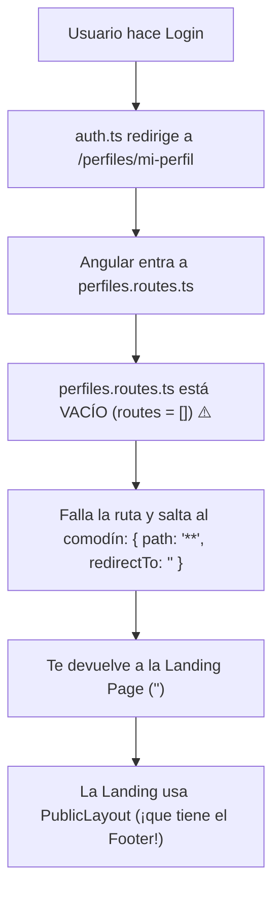

# 📘 Implementation Plan #23: Rol Vacío en Registro y Activación del `MainLayout`

| Campo | Detalle |
| :--- | :--- |
| **Identificador** | `PLAN-FE-23` |
| **Módulo / Capa** | `features/auth/pages/register` & `features/perfiles/perfiles.routes.ts` & `features/enterprise/enterprise.routes.ts` |
| **Objetivo de Aprendizaje** | 1. Tipar limpiamente estados iniciales vacíos de formularios en TypeScript con la utilidad `Omit`.<br>2. Resolver el misterio del rebote: comprender por qué un archivo de rutas hijas vacío (`routes = []`) activa el comodín `**` enviándote a la Landing con footer. |
| **Archivos Involucrados** | <ul><li>`[MODIFY]` [register.ts](file:///c:/Users/joaki/OneDrive/Escritorio/WorkLink/src/app/features/auth/pages/register/register.ts)</li><li>`[MODIFY]` [perfiles.routes.ts](file:///c:/Users/joaki/OneDrive/Escritorio/WorkLink/src/app/features/perfiles/perfiles.routes.ts)</li><li>`[MODIFY]` [enterprise.routes.ts](file:///c:/Users/joaki/OneDrive/Escritorio/WorkLink/src/app/features/enterprise/enterprise.routes.ts)</li></ul> |

---

## 1. Explicación Didáctica (Modo Profesor)

### A. ¿Cómo declarar el rol vacío en [register.ts](file:///c:/Users/joaki/OneDrive/Escritorio/WorkLink/src/app/features/auth/pages/register/register.ts)?

En tu archivo tienes:
```typescript
export interface FormularioRegistro extends RegisterRequestDTO {
  confirmPassword: string;
}
```
Y tu `RegisterRequestDTO` define `rol: UserRole`. Como `UserRole` solo acepta `'EMPRESA' | 'FREELANCER' | ...`, TypeScript no te permite poner `rol: ''` porque `''` no es un rol válido del sistema.

#### La Solución Técnica en TypeScript (`Omit`):
Usamos la utilidad nativa `Omit` para decirle a TypeScript: *"Hereda todo de `RegisterRequestDTO` excepto `rol`, y permíteme que en el formulario `rol` pueda empezar como `UserRole | ''`"*:

```typescript
export interface FormularioRegistro extends Omit<RegisterRequestDTO, 'rol'> {
  confirmPassword: string;
  rol: UserRole | ''; // 👈 Permite iniciar en vacío antes de que el usuario elija
}
```

---

### B. El Misterio Resuelto: ¿Por qué te manda a la Landing y sigue saliendo el Footer?

¡Acabo de revisar tu código y encontré el culpable exacto! Mira la cadena de lo que estaba ocurriendo:



1. Al hacer login, tu servicio `auth.ts` redirige con éxito a:
   `/perfiles/mi-perfil`
2. Angular va a tu archivo [perfiles.routes.ts](file:///c:/Users/joaki/OneDrive/Escritorio/WorkLink/src/app/features/perfiles/perfiles.routes.ts).
3. **¡Pero `perfiles.routes.ts` estaba completamente vacío! (`export const routes: Routes = [];`)**.
4. Como Angular no encuentra ninguna página registrada para `mi-perfil`, salta automáticamente a tu regla comodín en `app.routes.ts`:
   `{ path: '**', redirectTo: '' }`
5. Y como `''` es la **Landing Page** (que vive dentro de `PublicLayout`), ¡te devuelve al inicio con el Footer!
6. Por esa razón nunca llegabas a ver el `MainLayout` ni el Sidebar.

---

## 2. Guía Paso a Paso para el Alumno

### Paso 1: Corregir el tipado en [register.ts](file:///c:/Users/joaki/OneDrive/Escritorio/WorkLink/src/app/features/auth/pages/register/register.ts)

En las líneas 13-15 de [register.ts](file:///c:/Users/joaki/OneDrive/Escritorio/WorkLink/src/app/features/auth/pages/register/register.ts), cambia la definición de `FormularioRegistro`:

```typescript
// Usamos Omit para permitir que el rol arranque vacío en el formulario:
export interface FormularioRegistro extends Omit<RegisterRequestDTO, 'rol'> {
  confirmPassword: string;
  rol: UserRole | ''; 
}
```
Y en tu `registerModel`:
```typescript
registerModel = signal<FormularioRegistro>({
  usuario: '',
  email: '',
  password: '',
  confirmPassword: '',
  rol: '' // ✅ Ahora TypeScript lo acepta sin ningún error
});
```

---

### Paso 2: Registrar la ruta en [perfiles.routes.ts](file:///c:/Users/joaki/OneDrive/Escritorio/WorkLink/src/app/features/perfiles/perfiles.routes.ts)

Abre [perfiles.routes.ts](file:///c:/Users/joaki/OneDrive/Escritorio/WorkLink/src/app/features/perfiles/perfiles.routes.ts) y agrega la ruta de `mi-perfil`:

```typescript
import { Routes } from '@angular/router';

export const routes: Routes = [
  {
    path: 'mi-perfil',
    loadComponent: () => import('./pages/mi-perfil/mi-perfil').then(m => m.MiPerfil)
  },
  {
    path: '',
    redirectTo: 'mi-perfil',
    pathMatch: 'full'
  }
];
```

---

### Paso 3: Registrar las rutas básicas en [enterprise.routes.ts](file:///c:/Users/joaki/OneDrive/Escritorio/WorkLink/src/app/features/enterprise/enterprise.routes.ts)

Para cuando pruebes iniciar sesión con rol `EMPRESA` o `RECRUITER`, abre [enterprise.routes.ts](file:///c:/Users/joaki/OneDrive/Escritorio/WorkLink/src/app/features/enterprise/enterprise.routes.ts) y registra sus páginas:

```typescript
import { Routes } from '@angular/router';

export const routes: Routes = [
  {
    path: 'vacantes',
    loadComponent: () => import('./vacantes/pages/vacante-admin/vacante-admin-list').then(m => m.VacanteAdminList)
  },
  {
    path: 'dashboard',
    loadComponent: () => import('./dashboard/pages/empresa-dashboard/empresa-dashboard').then(m => m.EmpresaDashboard)
  },
  {
    path: '',
    redirectTo: 'vacantes',
    pathMatch: 'full'
  }
];
```

---

## 3. Verificación

1. Guarda los cambios.
2. Inicia sesión en `/auth/login`.
3. Observarás la magia:
   * Como ahora la ruta `/perfiles/mi-perfil` **sí existe**, Angular no te rebotará a la Landing.
   * Se cargará el cascarón **`MainLayout`**.
   * Verás tu **Sidebar lateral a la izquierda**, la página de perfil a la derecha, y **el footer habrá desaparecido por completo**.
